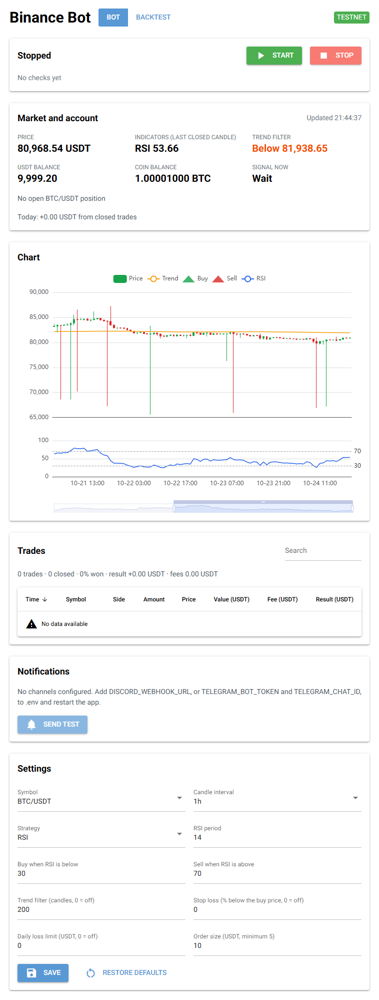
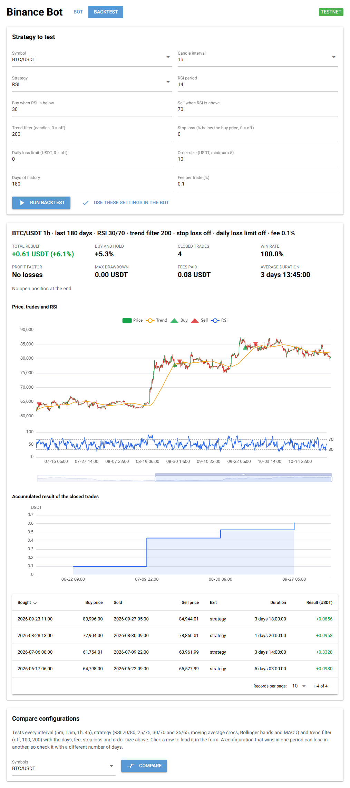
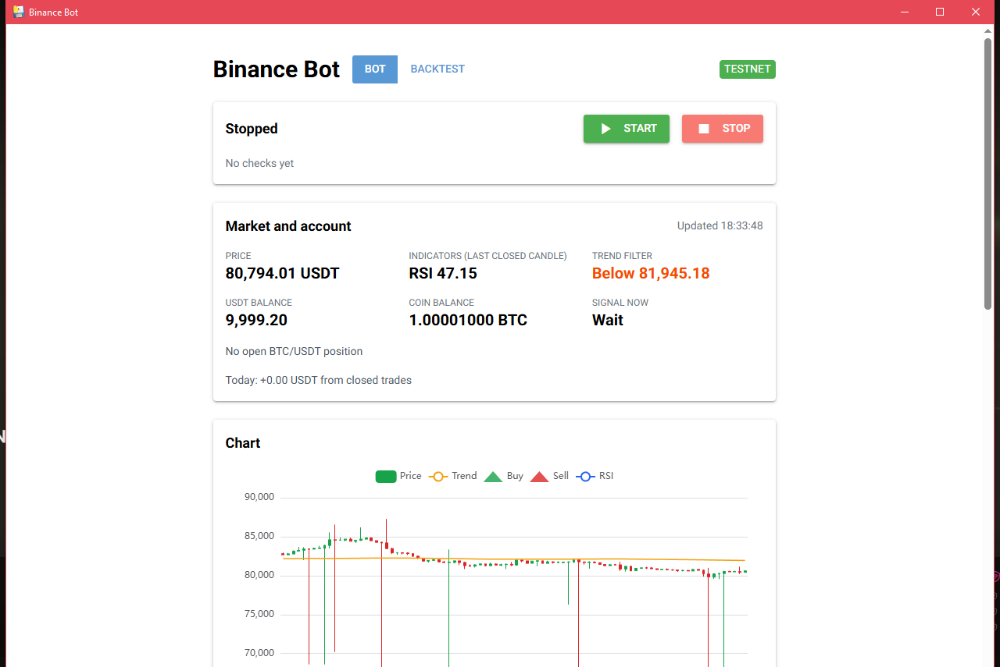

# Binance Bot

A trading bot for Binance Spot with a desktop app. It trades one coin at a time with one of four strategies, shows the
market, your balances and every trade, and can replay any configuration on historical data before you use it.

It runs on the **Binance Spot testnet** by default, so it trades with fake funds unless you explicitly switch it to the
real exchange.



## Features

- Four strategies: **RSI**, **moving average cross**, **Bollinger bands** and **MACD**, on 1 minute to 4 hour candles.
- **Trend filter**, **stop loss** and **daily loss limit** for any strategy.
- Live panel with price, indicators, balances, open position and today's result, plus a candlestick chart with the
  bot's buys and sells.
- Trade history with the result of every sell after fees.
- **Backtesting** on real Binance data, with metrics, charts and a comparison of 84 configurations per symbol.
- **Notifications** on Discord and Telegram.
- Everything is saved in a local SQLite file, so the bot picks up an open position after a restart.
- Windows app (`Binance Bot.exe`) with its own window: no browser, no console.

## Quick start

1. **Get testnet API keys.** Go to [testnet.binance.vision](https://testnet.binance.vision/), log in with GitHub,
   generate an **HMAC-SHA-256** key and copy the API key and secret.
2. **Create a folder** with `Binance Bot.exe` (see [Building the Windows app](#building-the-windows-app)) and a file
   called `.env` next to it:

   ```
   BINANCE_API_KEY=your testnet key
   BINANCE_API_SECRET=your testnet secret
   BINANCE_TESTNET=true
   ```

3. **Double-click `Binance Bot.exe`.** Check the settings, press **Start** and leave the window open. The bot works
   while the app is open; closing it stops the bot.

The first run creates `bot.db` (trades, positions, settings and historical candles) and `logs\` in the same folder.

## User guide

### Bot page

| Card | What it does |
|---|---|
| **Status** | **Start** and **Stop**, and the last check of the bot: time, price, indicators and trend. The bot checks once per candle, right after it closes. |
| **Market and account** | Current price, indicators of the last closed candle, whether the price is above the trend filter, your USDT and coin balances, what the strategy would do now, the open position with its profit or loss and today's result. Refreshed every 15 seconds. |
| **Chart** | The last 150 candles with the trend line, the strategy's lines, the bot's buys (green) and sells (red), and the RSI or MACD below. Zoom with the mouse wheel or the bar at the bottom. |
| **Trades** | Every buy and sell of the current account, with the fee and, for each sell, the result after fees. The summary shows the win rate, total result and fees. |
| **Notifications** | Which channels are configured, with a **Send test** button. |
| **Settings** | The bot's configuration. It can only be changed while the bot is stopped, and it is validated and saved when you press **Save**. |

### Settings

| Setting | Default | Meaning |
|---|---|---|
| Symbol | BTC/USDT | Coin to trade: BTC, ETH, SOL, BNB, XRP or DOGE against USDT |
| Candle interval | 1h | 1m, 5m, 15m, 1h or 4h. The bot checks once per candle |
| Strategy | RSI | See the table below. Only the fields of the chosen strategy are shown |
| Trend filter | 200 | Only buy while the price is above the average of this many candles. 0 turns it off |
| Stop loss | off | Sell when a candle closes this percentage below the buy price |
| Daily loss limit | off | After losing this many USDT in a day (local time), don't buy again until tomorrow. Open positions are still sold |
| Order size | 10 USDT | How much each buy spends. Binance's minimum is 5 USDT |

### Strategies

| Strategy | Buys when | Sells when |
|---|---|---|
| **RSI** (30/70) | The RSI drops below the buy level | The RSI goes above the sell level |
| **Moving average cross** (20/50) | The fast average crosses above the slow one | The fast average crosses below the slow one |
| **Bollinger bands** (20 candles, 2 deviations) | The price closes below the lower band | The price closes above the middle band |
| **MACD** (12/26/9) | The MACD line crosses above its signal line | The MACD line crosses below its signal line |

The bot only holds one position per symbol. It buys at market price for the order size and sells exactly what it
bought. Binance only accepts amounts in fixed steps, so a tiny bit of coin can be left after a sell; the bot remembers
it and adds it to the next sell, so it never piles up.

### Backtest page



Pick a configuration, the days of history and the fee, and press **Run backtest**. It downloads the candles it needs
from the real Binance market and replays the strategy, buying and selling at the open of the candle after each signal,
with Binance's rounding and the fee on every trade. You get:

| Metric | Meaning |
|---|---|
| Total result | Result of the closed trades plus the open position, in USDT and as a percentage of the order size |
| Buy and hold | What buying at the start and holding until the end would have made |
| Win rate | Percentage of closed trades with a profit |
| Profit factor | Total won divided by total lost. Above 1 the strategy makes money |
| Max drawdown | Biggest drop of the accumulated result from its highest point |
| Average duration | Average time between a buy and its sell |

Below them are the chart with the simulated trades, the accumulated result and the list of simulated trades.

**Compare** tests 84 configurations per symbol (4 intervals, 7 strategy variants and 3 trend filters) and sorts them
by result. Click a row to load it in the form, and **Use these settings in the bot** to save it for the bot.

A configuration that wins in one period can lose in another. Before trusting one, check it with a different number of
days and on other symbols.

### What the backtests showed

On 360 days of the six symbols, split into a falling market (−44% buy and hold) and a rising one (+2%):

- Short candles (1 to 15 minutes) lose with almost every configuration, especially without the trend filter: the
  fees eat the small moves.
- The **trend filter** improves every strategy, mostly by avoiding buys while the market falls.
- **1 hour candles, RSI 30/70 and a 200 candle trend filter** (the default) had the best result over both periods:
  +1.6% and +8.5% on average, with very few trades. Only two other configurations, both RSI with the trend filter,
  made a little money in both.
- The moving average cross on 4 hour candles did well in the rising market (+15.5%) but lost in the falling one.
- A stop loss didn't improve the results of these strategies; it mostly cut the trades that would have recovered.

### Notifications

The bot can send a message when it starts or stops, on every buy, sell and stop loss, when the daily loss limit is
reached, and on errors (a repeated error is sent only once). Add either channel, or both, to `.env` and restart the
app:

- **Discord:** in your server, *Server Settings → Integrations → Webhooks → New Webhook*, pick the channel and copy the
  webhook URL into `DISCORD_WEBHOOK_URL`.
- **Telegram:** talk to [@BotFather](https://t.me/BotFather), send `/newbot` and copy the token into
  `TELEGRAM_BOT_TOKEN`. Send any message to your new bot, open
  `https://api.telegram.org/bot<token>/getUpdates` and copy `message.chat.id` into `TELEGRAM_CHAT_ID`.

### Trading with real money

Don't, unless you accept losing the money you put in. If you do:

1. Create an API key on [binance.com](https://www.binance.com/en/my/settings/api-management) with **spot trading**
   enabled and **withdrawals disabled**, and restrict it to your IP address.
2. Put that key and secret in `.env` (testnet keys don't work on the real exchange) and set `BINANCE_TESTNET=false`.
3. Start with a small order size and the daily loss limit on.

In real mode the app shows a red banner, and **Start** asks you to type `REAL` before the bot runs. Trades, positions
and leftovers of the real account are kept apart from the testnet ones.

## Developer guide

### Tech stack

- **Python 3.14** with **[uv](https://docs.astral.sh/uv/)** for the Python version, environment and dependencies
- **[ccxt](https://github.com/ccxt/ccxt)** to talk to Binance
- **[pandas](https://pandas.pydata.org/)** for candles and indicators
- **[NiceGUI](https://nicegui.io/)** for the interface, with **ECharts** for the charts
- **SQLite** for trades, positions, settings and candles
- **[pywebview](https://pywebview.flowrl.com/)** and **[PyInstaller](https://pyinstaller.org/)** for the Windows app
- **[pytest](https://pytest.org/)** for the tests

### Running from source

```bash
curl -LsSf https://astral.sh/uv/install.sh | sh
cp .env.example .env
uv run app.py
```

Fill in `.env` first, then open [http://localhost:8080](http://localhost:8080). uv installs Python and the
dependencies on the first run. On Windows, `uv run app.py --window` opens the app in its own window instead.

| Variable | Description |
|---|---|
| `BINANCE_API_KEY`, `BINANCE_API_SECRET` | Binance API key and secret |
| `BINANCE_TESTNET` | `true` to use the testnet (default), `false` to trade with real money |
| `DISCORD_WEBHOOK_URL` | Optional. Discord webhook for notifications |
| `TELEGRAM_BOT_TOKEN`, `TELEGRAM_CHAT_ID` | Optional. Telegram bot and chat for notifications |

### Command line

| Command | What it does |
|---|---|
| `uv run bot.py` | Runs the bot without the interface, with the saved settings. Stop it with `Ctrl+C` |
| `uv run history.py --symbol BTC/USDT --interval 1h --days 30` | Downloads historical candles into `bot.db`, only the missing ones |
| `uv run backtest.py --symbol BTC/USDT --interval 1h --days 180 --fee 0.1` | Backtests the default strategy and prints the metrics |
| `uv run compare.py --symbols BTC/USDT ETH/USDT --days 180 --fee 0.1` | Compares the 84 configurations per symbol |

### Project structure

| File | Contents |
|---|---|
| `app.py` | Bot page and app entry point |
| `backtest_page.py` | Backtest page |
| `components.py` | Pieces shared by both pages: header, stats and settings form |
| `chart.py` | Chart options for ECharts |
| `bot.py` | The bot: a background thread that checks the strategy on every candle close and trades |
| `strategy.py` | Buy and sell rules of the four strategies, trend filter, stop loss and daily loss limit |
| `indicators.py` | RSI, moving averages, Bollinger bands and MACD |
| `settings.py` | Settings, defaults and validation |
| `market.py` | Binance connection, closed candles and the snapshot for the panel |
| `storage.py` | SQLite database |
| `journal.py` | Trade results and today's result |
| `notifier.py` | Discord and Telegram notifications |
| `history.py`, `backtest.py`, `compare.py` | Historical candles, backtest simulation and comparison |
| `paths.py` | Where `bot.db`, `logs` and `.env` live: next to the code, or next to the exe |

### Data

`bot.db` is a SQLite file. You can open it with [DB Browser for SQLite](https://sqlitebrowser.org/).

| Table | Contents |
|---|---|
| `trades` | Every buy and sell: time, symbol, side, amount, price, cost, fee, testnet or real, Binance order id |
| `positions` | The open position per symbol and account |
| `leftovers` | Coin left unsold after Binance's rounding, added to the next sell |
| `settings` | The settings saved from the app |
| `candles` | Historical candles from the real Binance market, for backtesting |

Everything the bot does is also written to `logs/bot.log`, which rotates at midnight and keeps the last 30 days.

### Tests

```bash
uv run pytest
```

65 tests cover the indicators, the strategies with the trend filter, stop loss and daily loss limit, the settings
validation, the database, the trade results, the backtest, the bot's buys and sells (including Binance's rounding and
the leftover coin) and both pages of the app. They use a fake exchange and a temporary database, so they run without
internet and never touch `bot.db`, the logs or your Binance account.

### Building the Windows app

On Windows, install uv in PowerShell with `irm https://astral.sh/uv/install.ps1 | iex`, clone the repository and run:

```powershell
.\build.ps1
```

It installs the desktop dependencies and creates `dist\Binance Bot.exe`, a single file of about 66 MB.



## Disclaimer

This is a learning project, not financial advice. The backtests only show how a strategy did in the past, with few
trades, and fees and sudden moves can make any of them lose money. Don't trade with money you can't afford to lose.
